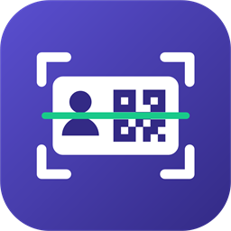
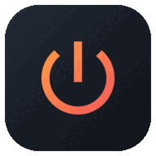
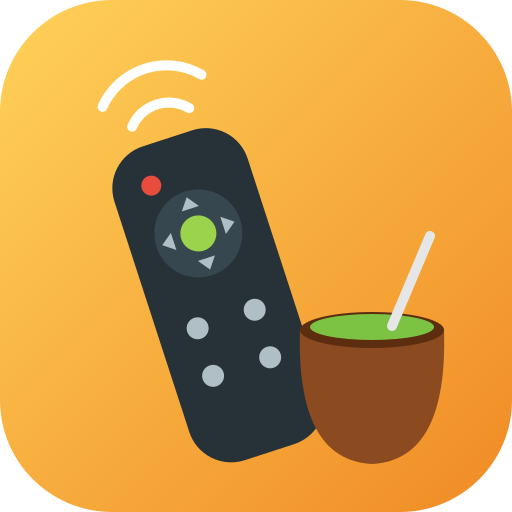
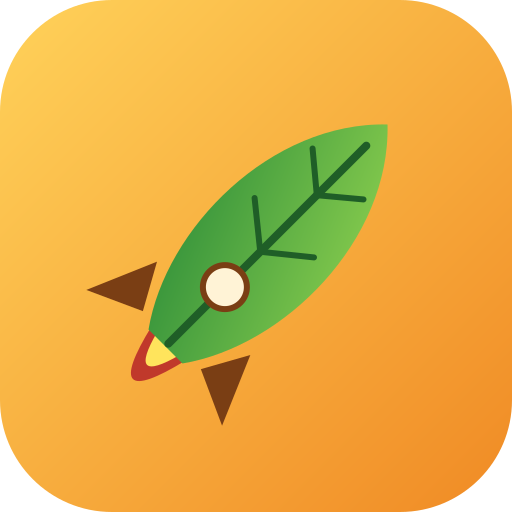

<h1 align="center">Software library</h1>

  <a href="README.md">Español</a> · <b>English</b>  
  <a href="https://cafecito.app/matcarfer">☕ Cafecito</a> · <a href="https://ko-fi.com/matcarfer">☕ Ko-fi</a> · <a href="https://www.patreon.com/matcarfer">❤ Patreon</a>

## 📱 Android

<table>
<tr><th width="30%">Name</th><th width="70%">Description</th></tr>
<tr><td colspan="2"><b>Paid Android apps (with free demo)</b></td></tr>
<tr><td>&nbsp; <b><a href="https://github.com/matcarfer/escaneo-dni-demo">Escaneo de DNI</a></b></td><td>Check people in at events with the QR of the Argentine ID card. App in Spanish.</td></tr>
<tr><td colspan="2"><b>Free Android apps</b></td></tr>
<tr><td>&nbsp; <b><a href="https://github.com/matcarfer/AutoAlToque">AutoAlToque</a></b></td><td>Live engine data of your car, alerts and fault codes. Needs a Bluetooth OBD2 adapter.</td></tr>
<tr><td>&nbsp; <b><a href="https://github.com/matcarfer/Cuadradito">Cuadradito</a></b></td><td>Animations, emojis and drawings on the MI Matrix Display LED square, over Bluetooth. App in Spanish.</td></tr>
<tr><td>&nbsp; <b><a href="https://github.com/matcarfer/PowerDeck">PowerDeck</a></b></td><td>Power and ADB menu for TV boxes and phones. Needs root; without root only ADB works.</td></tr>
<tr><td>&nbsp; <b><a href="https://github.com/matcarfer/Ratito">Ratito</a></b></td><td>Visual timer and routines for autistic children, children with ADHD and everyone.</td></tr>
<tr><td>&nbsp; <b><a href="https://github.com/matcarfer/RemoteMate">RemoteMate</a></b></td><td>Control your Chromecast with Google TV, smart TV (Android TV or Google TV) or Android TV box without its remote.</td></tr>
<tr><td>&nbsp; <b><a href="https://github.com/matcarfer/YerbaLauncher">YerbaLauncher</a></b></td><td>Replace the launcher of your old tablet or phone with a simple, super light one.</td></tr>
</table>

## 🪟 Windows

<table>
<tr><th width="30%">Name</th><th width="70%">Description</th></tr>
<tr><td colspan="2"><b>Free Windows utilities</b></td></tr>
<tr><td>&nbsp; <b><a href="https://github.com/matcarfer/InstantFTP">InstantFTP</a></b></td><td>Portable FTP server, super fast and lightweight (56 KB), no GUI: double-click and its folder is shared over the network.</td></tr>
</table>

## 🎮 Trainers

<table>
<tr><th width="30%">Name</th><th width="70%">Description</th></tr>
<tr><td colspan="2"><b>Free PC game trainers</b></td></tr>
<tr><td>&nbsp; <b><a href="https://github.com/matcarfer/vampire-survivors-trainer">Vampire Survivors</a></b></td><td>11 cheats with keyboard shortcuts. Offline only. For the Steam version (64-bit).</td></tr>
<tr><td>&nbsp; <b><a href="https://github.com/matcarfer/warhammer-survivors-trainer">Warhammer Survivors</a></b></td><td>11 cheats with keyboard shortcuts. For the GOG version (64-bit).</td></tr>
</table>

---

Each app has its own license, stated in its repository and inside the app. <a href="LICENSE.en">License</a>. 
Everything is provided as is, without warranty; use at your own risk. Donations are voluntary.

