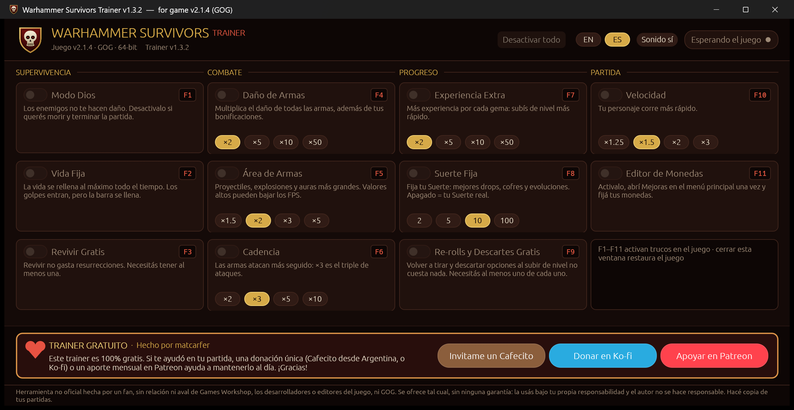

<p align="center">
  
</p>

<h1 align="center">matcarfer · Library</h1>

<p align="center">
  <b>Free downloads:</b> Android apps (APK) · Windows utilities · PC game trainers<br>
  <sub>Descargas gratis: apps para Android (APK) · utilidades para Windows · trainers para juegos de PC</sub>
</p>

<p align="center">
  <a href="https://github.com/matcarfer/library/releases"><b>⬇ All releases</b></a>
  &nbsp;·&nbsp;
  <a href="https://cafecito.app/matcarfer"><b>☕ Cafecito (AR)</b></a>
  &nbsp;·&nbsp;
  <a href="https://ko-fi.com/matcarfer"><b>☕ Ko-fi</b></a>
  &nbsp;·&nbsp;
  <a href="https://www.patreon.com/matcarfer"><b>❤ Patreon</b></a>
</p>

Everything here is **free**. Each item has its own release: open it, download the file
under **Assets**, and check the SHA-256 listed in the release notes.

---

## 📱 Android apps (APK)

| App | Version | Download | Description |
|---|---|---|---|
| *Coming soon* | | | |

## 🪟 Windows utilities

| Program | Version | Download | Description |
|---|---|---|---|
| *Coming soon* | | | |

## 🎮 PC game trainers

| Trainer | Game version | Version | Download |
|---|---|---|---|
| **Warhammer Survivors Trainer** | v2.1.4 · GOG · 64-bit | 1.3.2 | [⬇ Download](https://github.com/matcarfer/library/releases/tag/warhammer-survivors-trainer-v1.3.2) |

<details>
<summary><b>Warhammer Survivors Trainer</b> — 11 cheats, F1–F11 hotkeys, English/Español</summary>

<br>


God Mode · Health Lock · Keep Revives · Weapon Damage ×2–×50 · Weapon Area ×1.5–×5 ·
Fire Rate ×2–×10 · XP Boost ×2–×50 · Luck Override · Free Rerolls & Banishes ·
Move Speed ×1.25–×3 · Coin Editor.

Requires **Warhammer Survivors v2.1.4 (GOG, 64-bit)** on Windows 10/11. Run the trainer
before or after the game; closing it restores the game.
</details>

---

## How to download safely

- Download only from this page (**Releases**). Copies elsewhere are not official.
- Compare the file's hash with the one in the release notes:
  ```powershell
  Get-FileHash .\<file> -Algorithm SHA256
  ```
- Programs are not code-signed: if Windows SmartScreen appears, click
  **More info → Run anyway**. Trainers may be flagged by antivirus software because they
  modify a game's memory.
- **Back up your save files** before using a trainer.

## Disclaimer

Unofficial tools made by a fan. Not affiliated with or endorsed by the developers,
publishers or stores of the games and apps they work with. All trademarks belong to
their owners. Provided **as is, without any warranty**: you use them at your own risk
and the author accepts no liability.

## License

Freeware, closed source: free to download and use; **redistribution, re-uploading,
modification and resale are not allowed** — share a link to this page instead.
See [LICENSE](LICENSE).

## Support

Everything is free. If something helped you, **$1 is enough, and any extra is hugely
appreciated**:
[Cafecito](https://cafecito.app/matcarfer) (Argentina) ·
[Ko-fi](https://ko-fi.com/matcarfer) (one-time) ·
[Patreon](https://www.patreon.com/matcarfer) (monthly).

---

### Español

Todo es **gratis**. Cada herramienta tiene su propio *release*: abrilo, descargá el
archivo en **Assets** y verificá el SHA-256 de las notas. Si Windows muestra
"Windows protegió tu PC", elegí **Más información → Ejecutar de todas formas**.
Herramientas no oficiales, sin garantía y bajo tu propia responsabilidad. No está
permitido redistribuirlas: compartí el link a esta página. Si algo te sirvió, con US$1
alcanza, y si querés dar más, ¡mucho mejor!
