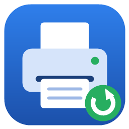
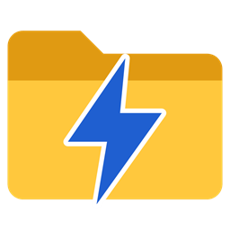
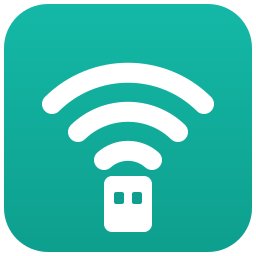

<h1 align="center">Biblioteca de software</h1>

  <b>Español</b> · <a href="README.en.md">English</a>  
  <a href="https://cafecito.app/matcarfer">☕ Cafecito</a> · <a href="https://www.matecito.co/matcarfer">🧉 Matecito</a> · <a href="https://link.mercadopago.com.ar/matcarfer">💙 Mercado Pago</a> · <a href="https://ko-fi.com/matcarfer">☕ Ko-fi</a> · <a href="https://www.patreon.com/matcarfer">❤ Patreon</a> · <a href="https://github.com/sponsors/matcarfer">💖 GitHub Sponsors</a>

## 📱 Android

<table>
<tr><th width="30%">Nombre</th><th width="70%">Descripción</th></tr>
<tr><td colspan="2"><b>Apps Android pagas (con demo gratis)</b></td></tr>
<tr><td>&nbsp; <b><a href="https://github.com/matcarfer/escaneo-dni-demo">Escaneo de DNI</a></b></td><td>Acreditá personas en eventos con el QR del DNI.</td></tr>
<tr><td colspan="2"><b>Apps Android gratis</b></td></tr>
<tr><td>&nbsp; <b><a href="https://github.com/matcarfer/AutoAlToque">AutoAlToque</a></b></td><td>Datos del motor de tu auto en vivo, alertas y códigos de falla. Necesita adaptador OBD2 Bluetooth.</td></tr>
<tr><td>&nbsp; <b><a href="https://github.com/matcarfer/Cuadradito">Cuadradito</a></b></td><td>Animaciones, emojis y dibujos en el cuadrado LED MI Matrix Display, por Bluetooth.</td></tr>
<tr><td>&nbsp; <b><a href="https://github.com/matcarfer/PowerDeck">PowerDeck</a></b></td><td>Menú de energía y ADB para Smart TVs (Android TV o Google TV), convertidores Smart Android, celulares y tablets. Necesita root; sin root solo funciona ADB.</td></tr>
<tr><td>&nbsp; <b><a href="https://github.com/matcarfer/Ratito">Ratito</a></b></td><td>Temporizador visual y rutinas para chicos con autismo, con TDAH y para todos.</td></tr>
<tr><td>&nbsp; <b><a href="https://github.com/matcarfer/RemoteMate">RemoteMate</a></b></td><td>Controlá sin control remoto tu Chromecast con Google TV, Smart TV (Android TV o Google TV) o convertidor Smart Android.</td></tr>
<tr><td>&nbsp; <b><a href="https://github.com/matcarfer/YerbaLauncher">YerbaLauncher</a></b></td><td>Cambiá el launcher de tu tablet o celular viejo por uno simple y súper liviano.</td></tr>
</table>

## 🪟 Windows

<table>
<tr><th width="30%">Nombre</th><th width="70%">Descripción</th></tr>
<tr><td colspan="2"><b>Utilidades para Windows gratis</b></td></tr>
<tr><td>&nbsp; <b><a href="https://github.com/matcarfer/actualizar-impresoras-de-red">Actualizar Impresoras de RED</a></b></td><td>Reinstalá desde cero las impresoras de red de una PC, con el driver que ya tiene. Código abierto.</td></tr>
<tr><td>&nbsp; <b><a href="https://github.com/matcarfer/BTDongleLab-Windows">BTDongleLab</a></b></td><td>Analizá tu dongle o placa Bluetooth: qué trae, para qué sirve y si promete de más.</td></tr>
<tr><td>&nbsp; <b><a href="https://github.com/matcarfer/InstantFTP">InstantFTP</a></b></td><td>Servidor FTP portable, súper rápido y liviano (56 KB), sin interfaz gráfica: doble clic y comparte su carpeta. Código abierto.</td></tr>
</table>

## 🐧 Linux

<table>
<tr><th width="30%">Nombre</th><th width="70%">Descripción</th></tr>
<tr><td colspan="2"><b>Utilidades para Linux gratis</b></td></tr>
<tr><td>&nbsp; <b><a href="https://github.com/matcarfer/aic8800-wifi6-linux">aic8800-wifi6-linux</a></b></td><td>Hacé andar en Linux, con un solo comando, la placa USB WiFi 6 + Bluetooth que aparece como pendrive.</td></tr>
</table>

---

Cada app tiene su propia licencia, especificada en su repositorio y dentro de la app. <a href="LICENSE">Licencia</a>. 
Todo se ofrece tal cual, sin garantía; usalo bajo tu responsabilidad. Las donaciones son voluntarias.

